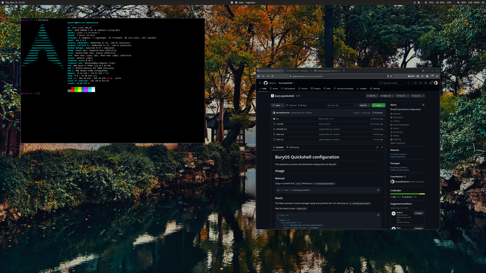

# BuryOS Hyprland configuration

This repository contains the Hyprland configuration for BuryOS.



## Usage

### Manual install

Copy or symlink the `./src` directory to `~/.config/hypr`:

```bash
cp -r ./src ~/.config/hypr
```

### NixOS

The flake assumes a home manager setup and symlinks the ./src directory as `~/.config/hypr`.

Add the input to your `flake.nix`:

```nix
# flake.nix
{
  inputs = {
    bury-hyprland = {
      url = "github:bury-os/bury-hyprland";
      inputs.nixpkgs.follows = "nixpkgs";
    };
  };
}
```

Import the bury-hyprland NixOS module in your NixOS config. This handles Hyprland at a system-level, enabling UWSM, etc.

```nix
# configuration.nix
{
  imports = [
    inputs.bury-hyprland.nixosModules.default
  ];
}
```

Import the bury-hyperland Home Manager module in your Home Manager config. This handles all the `~/.config/hypr` files setting Hyprland up with the custom configs.

```nix
# home.nix
{
  imports = [
    inputs.bury-hyprland.homeManagerModules.default
  ];
}
```